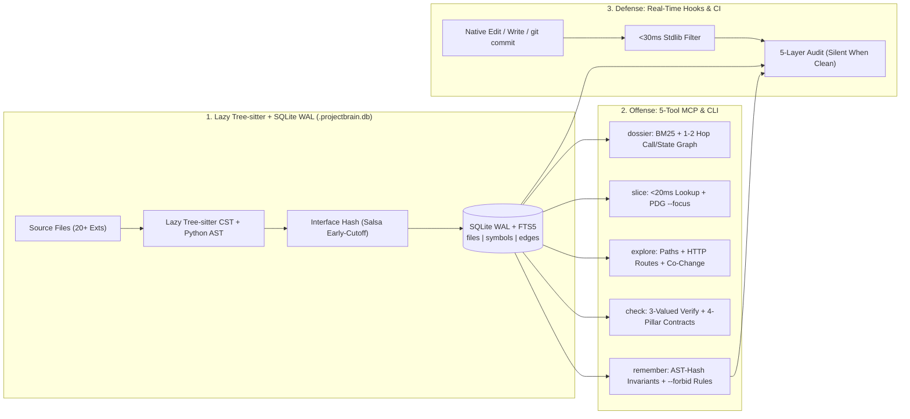

# ProjectBrain (`projectbrain-mcp` v1.0.0)

[](https://pypi.org/project/projectbrain-mcp/)
[](https://opensource.org/licenses/MIT)
[](https://www.python.org/downloads/)

**Zero-LSP SQLite Code Graph, Real-Time Blast-Radius & Cross-File Contract Guardrail, and PDG Context Compiler for AI Coding Agents.**

ProjectBrain gives Claude Code, Cursor, Antigravity, Windsurf, and CI pipelines both **Offense** (1-turn architectural context + `<20ms` surgical PDG slicing) and **Defense** (active post-edit blast-radius, contract, and layer-boundary guardrails) backed by a local SQLite WAL + FTS5 graph (`.projectbrain.db`) and lazy-loaded `tree-sitter` / Python `ast`. No LSP servers, no Docker, no cloud embeddings, and no API keys.

---

## Why ProjectBrain v1.0? (Offense + Defense)

AI coding agents edit fast with native `Edit` / `edit_file` tools, but routinely **break uninspected callers across files**, **violate layer boundaries**, or **burn 50k+ tokens** grep-crawling monoliths. ProjectBrain solves both without forcing agents to learn a custom edit DSL:

### 1. Defense: Active Real-Time Post-Edit Guardrail Hooks (`hooks.py`)
Installed automatically by `projectbrain init` into Claude Code (`.claude/settings.local.json` `PostToolUse`), Cursor (`.cursor/hooks.json` `afterFileEdit`), and optional Git `pre-commit`:
- **Silent When Clean (`0` Token Tax):** Non-code edits (`.md`, `.json`, `.toml`) exit in `<30ms` on a pure-stdlib fast path without importing Tree-sitter. Clean body-only code edits verify incrementally via Salsa early-cutoff and emit **zero bytes** (`exit 0`).
- **5-Layer Deterministic Rescue When Broken:** The instant a native edit introduces a regression, ProjectBrain injects a compact rescue report back into the agent's turn:
  1. **Pinpoint Syntax Errors** (`file.py:L42`) via Python `ast` & Tree-sitter CST `ERROR` nodes.
  2. **4-Pillar Cross-File Contracts** — caller argument arity mismatches, closed dict return-key removals, nominal parameter type mismatches, and SQL `NOT NULL` DDL schema violations.
  3. **Enforceable Architectural Boundaries** — blocks forbidden cross-layer imports/calls pinned via `projectbrain remember --forbid "routes/* -> db/*"`.
  4. **Public Signature Blast Radius** — diffs pre-edit vs. post-edit signatures across cold hook runs and lists downstream cross-file callers + covering `pytest`/`vitest` files when a signature changes or symbol is deleted.
  5. **AST-Hash Invariant Alerts** — flags `[INVARIANT MUTATED — VERIFY STILL HOLDS]` when a function with a pinned architectural invariant in `.projectbrain_memory.json` changes its AST hash.

### 2. Offense: Lean 5-Tool Zero-LSP MCP & CLI Surface (`server.py`)
By default (`projectbrain-mcp --lean`), ProjectBrain exposes **5 non-overlapping power tools** so it never bloats the agent's tool-schema budget:

| MCP Tool / CLI Command | Purpose |
| :--- | :--- |
| **`brain_dossier`** (`projectbrain dossier`) | **1-Turn Architecture Compiler:** Ranks relevant files & symbols via sub-identifier BM25 + 1–2 hop call/import/state-flow edges, returning class-qualified code slices, neighbor skeletons, covering tests, and pinned invariants in `~0.2s`. |
| **`brain_slice`** (`projectbrain slice`) | **`<20ms` Surgical Symbol & PDG Slicer:** Reads exact functions, methods (`Class.method`, `res.send`), file skeletons, or intra-function **Program Dependence Graph (`--focus var`)** slices (`backward defs` + `forward uses` + `enclosing guards`) directly from SQLite. |
| **`brain_explore`** (`projectbrain explore`) | **Unified Code Graph Navigator:** Traces callers/callees, shortest call/import path between `target` and `target_b`, full-stack `/api/...` route flows, and git `co_changes`. |
| **`brain_check`** (`projectbrain check`) | **Pre-Flight Verifier, 3-Valued Claim Gate & CI Reporter:** Fact-checks structural claims (`SUPPORTED` / `REFUTED` / `UNKNOWN` — never fabricates false refutations on syntax-broken files or dynamic receivers), validates multi-file edit plans, and outputs Ruff-style `text`, PR `markdown`, or GitHub Actions `--ci` annotations. |
| **`brain_remember`** (`projectbrain remember` / `memories`) | **Git-Tracked Repo Governance (`.projectbrain_memory.json`):** Pins symbol invariants anchored to normalized AST hashes and enforceable `--forbid "<src_glob> -> <dst_glob>"` layer rules shared across teammates and CI. |

*(Pass `--full` or `PROJECTBRAIN_FULL_TOOLS=1` to also expose auxiliary tools: `brain_context`, `brain_stats`, `brain_run`, `brain_patch`.)*

---

## Quick Start (60 Seconds)

### 1. Install (`uv` Recommended — Zero PEP 668 Friction)

```bash
# Recommended: isolated global CLI + MCP binaries via uv (or pipx)
uv tool install projectbrain-mcp

# Alternative: pipx
pipx install projectbrain-mcp

# Or inside an active Python virtual environment:
pip install projectbrain-mcp
```

### 2. Initialize Your Repository

```bash
projectbrain --path /path/to/your/repo init --git-hook
```

What `init` sets up non-destructively:
1. Indexes your repository into `.projectbrain.db` (SQLite WAL + FTS5) honoring `.gitignore` and `.git/info/exclude`.
2. Resolves absolute binary paths (`shutil.which` / `sys.executable -m`) so GUI IDEs (Cursor, Claude Desktop, VS Code) never hit `spawn ENOENT`.
3. Writes `.mcp.json` and non-destructive `<!-- projectbrain:start -->` workflow rules in `AGENTS.md` (plus `.cursor/` / `.vscode/` / `CLAUDE.md` when detected or via `--ide all`).
4. Installs active `PostToolUse` (`.claude/settings.local.json`), `afterFileEdit` (`.cursor/hooks.json`), and optional `.git/hooks/pre-commit` guardrails.
5. Keeps `.projectbrain.db` git-ignored while leaving `.projectbrain_memory.json` git-trackable so architectural invariants and `--forbid` rules travel with PRs.

### 3. MCP Server Configuration (or Zero-Install via `uvx`)

```json
{
  "mcpServers": {
    "projectbrain": {
      "command": "uvx",
      "args": ["--from", "projectbrain-mcp", "projectbrain-mcp", "--lean", "/path/to/your/repo"]
    }
  }
}
```

### 4. Core CLI Workflow

```bash
# 1. Compile a 1-turn architecture dossier directly to stdout
projectbrain --path /path/to/repo dossier "how are exceptions routed to error handlers"

# 2. Slice exact symbols or intra-function PDG variable flows (<20ms cold SQLite lookup)
projectbrain --path /path/to/repo slice billing.py:compute_invoice --focus discount_total

# 3. Pin an enforceable architectural boundary rule & symbol invariant (git-tracked)
projectbrain --path /path/to/repo remember --forbid "routes/* -> db/*" --reason "Routes must go through services/*"
projectbrain --path /path/to/repo remember settle_invoice "Must remain idempotent on duplicate invoice_id"
projectbrain --path /path/to/repo memories

# 4. Run blast-radius, contract, boundary & invariant check (Ruff-style text, PR markdown, or CI gate)
projectbrain --path /path/to/repo check
projectbrain --path /path/to/repo check --format markdown
projectbrain --path /path/to/repo check --ci

# 5. View regression interception & code-graph scorecard
projectbrain --path /path/to/repo stats --summary
```

### 5. `<2s` GitHub Actions CI / PR Guardrail

```yaml
name: ProjectBrain Architecture & Contract Gate
on: [pull_request]
jobs:
  guardrail:
    runs-on: ubuntu-latest
    steps:
      - uses: actions/checkout@v4
        with:
          fetch-depth: 0
      - uses: astral-sh/setup-uv@v4
      - name: Verify cross-file contracts, boundaries & blast radius
        run: uvx --from projectbrain-mcp projectbrain check --ci
```

---

## System Architecture



---

## Honest Tradeoffs, Limitations & When to Use `rg`

ProjectBrain is a deterministic static AST + lexical/graph engine, **not** an embedding model or runtime tracer:

1. **When plain `rg` / `grep` is better:** If you already know an exact literal string, error constant, or config key and only want line numbers, `rg` is faster and simpler.
2. **Lexical + Graph Ranking vs. Embeddings (`dossier`):** Indexing takes `~0.1–1.5s` locally with zero API keys or model downloads. If a query uses completely different words from the codebase's identifiers and docstrings (naming zero symbols), lexical ranking can miss entry points until you supply a domain term.
3. **Static Analysis vs. Dynamic Dispatch (`verify` / `check`):** Calls through runtime-assigned variables (`adapter = self.get_adapter(url); adapter.send(req)`) cannot be proven to hit a single concrete class statically. `dossier` surfaces candidate edges (`send -> HTTPAdapter.send`), while `verify` honestly returns **`UNKNOWN`** rather than fabricating a false `REFUTED` or `SUPPORTED`.
4. **Language Tier Depth:**
   - **Tier 1 (Python, TypeScript/JavaScript):** Full AST/CST parsing (CommonJS, prototypes, `@typing.overload` dedup), intra-function PDG `--focus` slicing, relative/barrel/`tsconfig` alias resolution, route inference (FastAPI, Flask, Django, Next.js, Express, Hono), and 4-pillar cross-file contract verification.
   - **Tier 2 (Go, Rust, Java, Kotlin, C/C++, C#, Ruby, PHP):** Tree-sitter structural symbol extraction, call/import graph edges, CST PDG slicing (`.go`, `.rs`, `.java`), skeletons, and boundary/syntax guardrails.
   - **Tier 3 (SQL, GraphQL, Prisma, Protobuf, Vue/Svelte, Scala, Swift):** DDL table/column/`NOT NULL` constraint extraction, schema-to-code linking, SFC script extraction, and symbol/line slicing.

---

## Reproducible Benchmarks (`projectbrain/eval/`)

All evaluation scripts are checked into [`projectbrain/eval/`](projectbrain/eval/) and enforced in CI:

```bash
# 1. Fixture regression guards, self-dogfooding, and zero-ID adversarial evaluation
python projectbrain/eval/run_eval.py

# 2. 200-file polyglot scale, incremental Salsa early-cutoff, FTS5, and recursive CTE latency benchmark
python projectbrain/eval/bench_scale.py

# 3. External repository benchmarks: pallets/flask, django/django, psf/requests, pallets/click, expressjs/express
python projectbrain/eval/bench_external.py --suite all

# 4. Full unit, guardrail, anti-leakage, security, and regression test suite (220 tests)
pytest projectbrain/tests -q
```

### 1. Held-Out External Repository Benchmark (`python projectbrain/eval/bench_external.py --suite heldout`)

| Repository | Dossier Questions | Target Symbol Slice Recall | Cost per Hit | Structural & Slicing Checks |
| :--- | :---: | :---: | :---: | :--- |
| **`psf/requests`** | 4 questions (`proxies`, `redirects/auth`, `cookies`, `adapters/pool`) | **`15 / 15` (`100%`)** | `3.71 KB` | `verify_claim("Session.send", "calls", "HTTPAdapter.send")` -> **`UNKNOWN`** (dynamic receiver `adapter.send`, never false `REFUTED`); `slice_symbols(["should_strip_auth", "get_environ_proxies"])` -> `2 / 2` |
| **`pallets/click`** | 3 questions (`option/arg parsing`, `Group subcommand dispatch`, `ParamType converters`) | **`9 / 11` (`81.8%`)** | `4.95 KB` | **`0` bare `__init__` headers** (all methods qualified as `ClassName.method`, e.g. `Group.invoke`, `Group.resolve_command`) |
| **`expressjs/express`** | 3 questions (`res.send content-type`, `app.use mounting`, `app.handle dispatch`) | **`6 / 6` (`100%`)** | `2.34 KB` | `lib/response.js`: **32 functions** indexed; `lib/application.js`: **18 functions** indexed; `slice_symbols(["res.send", "app.use", "app.handle"])` -> **`3 / 3`** |
| **Combined Held-Out Total** | **10 questions** | **`30 / 32` (`93.8%`)** | **`3.81 KB`** | — |

### 2. Scale & Incremental Latency (`pallets/flask` & `django/django`)

| Benchmark | Result |
| :--- | :---: |
| **`pallets/flask` (6 Architectural Questions) — Target Function Slice Recall** | **`21 / 21` (`100%`)** (`2.66 KB` / hit) |
| **`django/django` (`3,051` files) — Single-File Body Edit `incremental_index()`** | **`~515 ms`** (`salsa_early_cutoff: True`) |
| **`django/django` (`3,051` files) — Single-File Signature Edit `incremental_index()`** | **`~894 ms`** (`O(Δ)` subgraph update) |
| **Cold Python Import (`from projectbrain.brain import ProjectBrain`)** | **`~150 ms`** (`3.15x` faster via lazy Tree-sitter C grammar loading) |
| **Non-Code Hook Bailout (`projectbrain hook post-edit` on `.md` / `.json`)** | **`< 30 ms`** (pure stdlib fast-path, `0` bytes emitted) |

### 3. Built-In Verification, Self-Dogfood & Adversarial Suite (`python projectbrain/eval/run_eval.py`)

| Suite | Scope | Metric | Result |
| :--- | :--- | :--- | :---: |
| **File Localization (`eval/tasks.json`)** | Fixture repos (10 tasks) | Precision / Recall | **`100%` / `100%`** |
| **Multi-Hop Graph vs. Grep (`eval/relationship_tasks.json`)** | Fixture repos (8 tasks, incl. negative controls) | Pass Rate | **`8 / 8` (`100%`)** |
| **Closed-World Claim Verification (`eval/claim_tasks.json`)** | Fixture repos (22 tasks) | Exact Verdict Accuracy | **`22 / 22` (`100%`, `0` false refutations)** |
| **Self-Dogfooding (`compile_context`)** | ProjectBrain repo (3 tasks, 6 target symbols) | Symbol Recall | **`100%` (`6 / 6` symbols)** |
| **Adversarial Zero-Identifier (`compile_context`)** | ProjectBrain repo (4 tasks, 8 target symbols; zero function names in prompt) | Symbol Recall | **`87.5%` (`7 / 8` symbols vs `50.0%` for disciplined `grep`)** |
