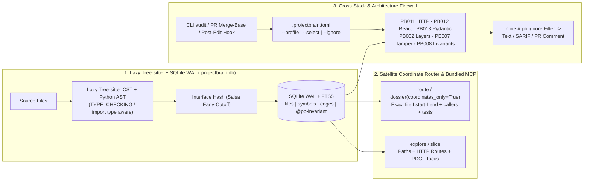

# ProjectBrain (`projectbrain-mcp` v1.4.0)

[](https://pypi.org/project/projectbrain-mcp/)
[](https://opensource.org/licenses/Apache-2.0)
[](https://www.python.org/downloads/)
[](https://johanabhishek.github.io/projectbrain-docs/)

**Zero-LLM Cross-Stack Contract Firewall, Satellite Coordinate Router & Sub-2s PR Architecture Gate for AI-Generated Code (CLI, CI SARIF & Bundled MCP Server).**

Single-language compilers (`pyright`, `tsc`, `ruff`, `eslint`) are blind across the **HTTP network boundary** and **repo architecture rules**. Cloud AI PR reviewers (CodeRabbit, Greptile) are slow, probabilistic, and require sending code off-machine. **ProjectBrain sits cleanly between them**: a `<1.5s`, 100% local, zero-API-key static analyzer & live SQLite code-graph router that catches cross-stack FastAPI/Pydantic ↔ React/TS schema & Express verb bugs (`PB011`–`PB013`), enforces layer boundaries (`--forbid`) and code-native `@pb-invariant:` rules, blocks governance/config tampering in PRs, and routes coding agents to exact `file:Lstart-Lend` coordinates without dumping truncated code.

---

## Try in 10 Seconds (Zero Config, Zero Dotfiles Written)

Run a full read-only cross-stack & semantic audit on any repository without installing permanently or writing a single `.projectbrain*` or IDE config file:

```bash
# Non-overlapping profile for teams already running ruff / pyright / tsc / eslint:
uvx --from projectbrain-mcp projectbrain audit --profile fullstack

# Or scan all PB001–PB013 rules:
uvx --from projectbrain-mcp projectbrain audit

# Satellite Coordinate Router: send a task signal -> get exact file:Lstart-Lend spans + callers + tests
uvx --from projectbrain-mcp projectbrain route "how are invoices validated and settled"
```

---

## How ProjectBrain Complements Your Existing Stack

ProjectBrain is designed to **pair with** your compilers and AI reviewers, not replace them:

| Tool Layer | What It Catches | Blind Spot | How ProjectBrain Fills the Gap (`--profile fullstack`) |
| :--- | :--- | :--- | :--- |
| **`ruff` / `pyright` / `tsc` / `eslint`** | Single-language syntax, types, lints | Blind across Python ↔ TS HTTP boundaries, repo layers, and AST-locked business invariants | **`PB011`** FastAPI/Pydantic ↔ React schema solver (+ FastAPI/Express HTTP verb & route checks); **`PB012`** React stateful remount & async effect races; **`PB013`** Pydantic `.model_dump()` partial-update clobbers |
| **LLM PR Reviewers** *(CodeRabbit, Greptile, Bugbot)* | High-level logic & style feedback | 30–90s latency, probabilistic noise, cloud code egress, per-seat cost | **`<2s` deterministic local/CI gate**, zero API keys, OASIS SARIF v2.1.0, sticky Mermaid PR impact summaries |
| **Native Coding Agents** *(Claude Code, Cursor, Antigravity)* | Fast `rg`, parallel `read_file`, native `Edit` | Blindly break uninspected callers, violate layer rules, or edit past business invariants | **Satellite Coordinate Router** (`route` / `brain_dossier(coordinates_only=True)`) + **Post-Edit Hook Relay** (silent when clean; redirects exact broken `file:L` on regressions) |

---

## What's New in v1.4.0

1. **Zero-Write 10-Second Trial (`projectbrain audit`):** Runs whole-repo `<1.5s` cross-stack & semantic triage strictly in-memory when no `.projectbrain.db` exists (pass `--save-index` only when you want a local cache).
2. **CI-Grade Escape Hatches (`.projectbrain.toml`, `--profile`, `# pb:ignore`):**
   - Configure `profile`, `select`, `ignore`, and `exclude` in `.projectbrain.toml` or `[tool.projectbrain]` inside `pyproject.toml`.
   - Use `--profile fullstack` (`PB002, PB007, PB008, PB011, PB012, PB013`) alongside `pyright`/`tsc`/`ruff` with zero duplicate noise, or `--profile governance` (`PB002, PB007, PB008, PB010`).
   - Suppress intentional exceptions inline via `# pb:ignore PB013 -- deliberate full reset` or `// pb:ignore PB012 -- fire-and-forget` (same line, immediately preceding comment line, or directly above single/multi-line decorators and function headers). Both `PB007` (Governance Tamper Lock) and `PB002` (team-pinned `--forbid` boundary rules) are immune to inline source-comment suppression by default (`PB002` can only be opted in via tamper-locked `allow_inline_boundary_ignore = true`).
3. **Pure Satellite Coordinate Router (`projectbrain route` / `brain_dossier(..., coordinates_only=True)`):**
   - Agent sends a lightweight task signal → Brain bounces back exact `file:Lstart-Lend` GPS coordinates, 1-hop callers/callees, HTTP route peers, covering tests, and touched invariants in ~500 tokens — zero truncated code dumps, letting agents use native `read_file`/`edit_file` directly.
4. **Code-Native Invariants (`# @pb-invariant:` / `// @pb-invariant:`):**
   - Write `# @pb-invariant: Must remain idempotent on duplicate invoice_id` directly above any function or class; `check` and post-edit hooks automatically surface it whenever that file is edited, and `projectbrain remember --sync-annotations` locks its AST hash into `.projectbrain_memory.json`.
5. **Type-Only Import Semantics & Safer `learn`:**
   - Python `if TYPE_CHECKING:` and TypeScript `import type` statements are excluded from runtime `import_targets`, `PB002` layer boundaries, and `learn` (while remaining available for cross-file schema resolution).
   - `projectbrain learn` skips noisy file-to-file bans in flat single-package repos by default (opt-in via `--include-module-rules`).
6. **Parametric URL Matching & Tighter React Race Detection:**
   - `PB011` matches concrete frontend ID segments (`/api/v1/users/u_42`) against parametric backend routes (`/api/v1/users/{user_id}`), and `PB012` checks actual `AbortSignal` usage so variables like `signalStrength` never mask uncancelled async races.

---

## Core Capabilities

### 1. Cross-Stack & Semantic Firewall (`PB001`–`PB013`)
- **`PB011` Cross-Stack HTTP Request & Response Schema Solver:** Deterministically verifies JS/TS `fetch` (including `{ ...auth, method: "POST" }` and `.then(r => r.json()).then(...)` chains), `axios`, 1-hop client functions, and cross-file 2-hop transport wrappers against mounted FastAPI/Pydantic v1/v2 (`BaseModel`, `SQLModel`, `TypedDict`, `@dataclass`, both `ConfigDict(...)` and dict `model_config`) request/response schemas and FastAPI/Express HTTP verb & route mounts — catching missing required fields (`422`), `camelCase <-> snake_case` payload drift, `extra="forbid"` violations, missing `Query(...)` params, response property mismatches (including CST-parsed `list[Model]` `.map()` item/destructured reads and typed TS `const data: Dto = await res.json()`), and HTTP verb mismatches while respecting `{...spread}`, `Field(alias=...)`, `alias_generator`, `extra="allow"`, default `extra="ignore"` extra client keys, `Depends(...)`, and Axios `.data`. *(Note: Express routes currently verify HTTP verb & path matching, not request/response body schemas.)*
- **`PB012` React Stateful Lifecycle, Remount & Async Race Verifier:** Uses Tree-sitter CST to catch post-mount same-handler `true -> false` loading/saving early-returns (`if`/`if-else`) and ternaries (including arbitrary container-wrapped branches and inline `onClick={async () => ...}` handlers) unmounting stateful child components (tracking direct `useState`/`useReducer` and custom hooks across files while skipping mount-only bootstrap spinners, resettable screens like `Order Confirmed` + `New Order`, synchronous edit/preview toggles, and `key={...}` boundaries), inline nested `PascalCase` component definitions, and uncancelled `useEffect([dep])` async `setState` races (including point-free `.then(setItems)` and 1-hop local async helpers without false-skipping on `.then()` returns, DOM `ref.current.focus()`, or `{ signal: "buy" }` JSON keys).
- **`PB013` Python Pydantic Partial-Update & Transactional I/O Hazard Verifier:** Flow-sensitively catches `PATCH`/`PUT`/update handlers calling `.model_dump()` / `.dict()` without `exclude_unset=True` and overwriting columns via `setattr(...)`, `.sqlmodel_update(...)`, `.update(...)`, `.model_copy(update=...)`, or `{**existing, **dump}` (while respecting filtered reassignments like `{k: v for k, v in data.items() if v is not None}`), plus silent broad `except: pass` around `.commit()`, webhook/email/payment side effects, or outbound HTTP mutations (`requests`/`httpx`/`aiohttp` clients including `with httpx.Client() as c:`).
- **PR Merge-Base Diffing & Governance Tamper Lock (`PB002`, `PB007`, `PB008`, `PB010`):** Audits multi-commit PRs against `git merge-base` (auto-detecting GitHub, GitLab, Bitbucket, and Azure PR envs), enforces `--forbid` architectural layers (with exact import line numbers, immune to `# pb:ignore PB002` by default) and `@pb-invariant:` rules (supporting multi-line decorators and preserving stale `PB008` hashes on `--sync-annotations`), blocks unauthorized deletion/weakening of `.projectbrain_memory.json` rules OR adding/weakening `.projectbrain.toml` / `[tool.projectbrain]` configs even on zero-config repos (`PB007`), and outputs `text`, `json`, `markdown`, `pr-comment` (sticky Mermaid blast-radius + advisories comment), `github` (errors + warnings), or OASIS `sarif` v2.1.0.

### 2. Configuration (`.projectbrain.toml` or `pyproject.toml`)

```toml
# .projectbrain.toml (or [tool.projectbrain] inside pyproject.toml)
profile = "fullstack"          # all | fullstack | governance
ignore = ["PB010"]             # optional additional rule exclusions
exclude = ["generated/*", "migrations/*"]
```

Inline suppression & code-native invariants:

```python
# @pb-invariant: Must remain idempotent on duplicate invoice_id
@router.patch("/invoices/{invoice_id}")
def patch_invoice(invoice_id: str, payload: InvoicePatch, db=Depends(get_db)):
    data = payload.model_dump(exclude_unset=True)  # safe partial update
    ...
```

```ts
// pb:ignore PB012 -- intentionally fire-and-forget analytics ping
useEffect(() => {
  fetch(`/api/v1/ping?tab=${tabId}`).then(() => setLastPing(Date.now()));
}, [tabId]);
```

### 3. Satellite Coordinate Router & Bundled 5-Tool MCP Server (Optional to Wire)
The `projectbrain-mcp` package bundles the MCP SDK and 6 Tree-sitter language grammars so both CLI and MCP work out of the box via `uvx` (wiring `.mcp.json` is optional — every command works standalone from the CLI and CI). When wired into Claude Code, Cursor, or Antigravity (`projectbrain-mcp --lean`), ProjectBrain exposes **5 non-overlapping MCP tools**:

| MCP Tool / CLI Command | Role in the Satellite Loop |
| :--- | :--- |
| **`brain_check`** (`projectbrain audit` / `check`) | **Firewall & Anomaly Triage:** `<1.5s` whole-repo semantic audit (`audit=True`), PR merge-base gate (`base_ref="main"`), pre-edit `plan_files` impact check, and 3-valued claim verification (`SUPPORTED` / `REFUTED` / `UNKNOWN`). |
| **`brain_dossier`** (`projectbrain route` / `dossier`) | **Satellite Coordinate Router & Context Compiler:** Pass `coordinates_only=True` (or CLI `route`) for ~500-token exact `file:Lstart-Lend` coordinates + callers/callees + tests + invariants; omit for full `<8 KB` inline AST/PDG slices. |
| **`brain_explore`** (`projectbrain explore`) | **Graph Navigator:** Traces callers/callees, shortest path `A -> B`, full-stack `/api/...` route flows, and git `co_changes`. |
| **`brain_slice`** (`projectbrain slice`) | **`<20ms` Surgical Symbol & PDG Slicer:** Extracts specific symbols, file skeletons, React monolith maps, or intra-function PDG variable slices (`--focus var`). |
| **`brain_remember`** (`projectbrain remember` / `memories`) | **Git-Tracked Governance (`.projectbrain_memory.json`):** Pins `--forbid` layer rules, `--co-change` contracts, and AST-hash invariants (including `action="sync"` / `--sync-annotations` for inline `@pb-invariant:` comments). |

*(Pass `--full` or `PROJECTBRAIN_FULL_TOOLS=1` to also expose auxiliary tools: `brain_learn`, `brain_context`, `brain_stats`, `brain_run`, `brain_patch`.)*

---

## Full Setup (Local Hooks, Team CI & Bundled MCP Server)

```bash
# Install isolated CLI + MCP binaries via uv (or pipx / pip)
uv tool install projectbrain-mcp

# 1. Zero-write audit (try first!)
projectbrain audit --profile fullstack

# 2. Optional: initialize local index, .mcp.json, rules, and silent-when-clean post-edit hooks
projectbrain --path /path/to/repo init --git-hook

# 3. Optional: OS-portable team hooks + GitHub Actions PR guardrail workflow
projectbrain --path /path/to/repo init --team

# 4. Preview (or --apply) discovered layer boundaries & co-change rules
projectbrain learn
projectbrain remember --sync-annotations
```

### `<2s` GitHub Actions PR Gate

```yaml
name: ProjectBrain Cross-Stack & Architecture Gate
on: [pull_request]
jobs:
  guardrail:
    runs-on: ubuntu-latest
    steps:
      - uses: actions/checkout@v4
        with:
          fetch-depth: 0
      - uses: astral-sh/setup-uv@v4
      - name: Cross-stack schema, React lifecycle & architecture check
        run: uvx --from projectbrain-mcp projectbrain check --profile fullstack --ci
```

### Wiring the Bundled MCP Server (Optional)

```json
{
  "mcpServers": {
    "projectbrain": {
      "command": "uvx",
      "args": ["--from", "projectbrain-mcp", "projectbrain-mcp", "--lean", "/path/to/your/repo"]
    }
  }
}
```

---

## System Architecture



---

## Honest Tradeoffs, Scope & Language Support Tiers

ProjectBrain is a deterministic static AST + graph engine — **not** an embedding model, full typechecker, or runtime tracer:

1. **Single-Repo Scope & Framework Boundaries Today:** `PB011` cross-stack HTTP schema checking requires frontend and backend code to live in the **same repository** (monorepo) and extracts request/response schemas from **FastAPI + Pydantic v1/v2 / SQLModel / `TypedDict` / `@dataclass`** backends with direct or 1–2 hop `fetch`/`axios` clients. **Express** routes currently support HTTP verb/path matching and route-graph tracing, *not* request/response body schema extraction (Zod/Joi/OpenAPI SDKs and split FE/BE repositories are outside its static proof boundary today).
2. **When Plain `rg` + `read_file` Is Better:** For exact literal lookups, `<=6` well-named files, small files (`<=350` lines), or auditing a single React monolith component end-to-end, use native `rg` + `read_file` directly — then run `brain_check` / `projectbrain audit` as your `<2s` verification gate.
3. **Static Analysis vs. Dynamic Dispatch:** Calls through runtime-assigned variables (`adapter = self.get_adapter(url); adapter.send(req)`) cannot be proven statically; `verify` honestly returns **`UNKNOWN`** instead of fabricating a false `REFUTED` or `SUPPORTED`.
4. **Honest Language Support Tiers:**
   - **Tier 1 — Full Semantic & Cross-Stack (Tree-sitter + Python AST):** **Python, TypeScript, JavaScript, JSX, TSX** — full call/import/type-only resolution, `PB001`–`PB013`, cross-stack FastAPI/Pydantic ↔ React schema verification (+ Express verb/route matching), intra-function PDG `--focus` slicing, and inline `@pb-invariant:` tracking.
   - **Tier 2 — Tree-sitter Structural (Bundled Grammars):** **Go, Rust, Java** — Tree-sitter symbol/call/import graph, CST PDG slicing, file skeletons, syntax checks (`PB001`), `--forbid` layer rules (`PB002`), and inline `@pb-invariant:` tracking.
   - **Tier 3 — Lightweight Regex / DDL Fallback (*Not* Tree-sitter):** **Kotlin, C/C++, C#, Ruby, PHP, Scala, Swift, SQL, GraphQL, Prisma, Protobuf, Vue/Svelte** — best-effort regex symbol/DDL extraction and line slicing (not backed by bundled Tree-sitter C grammars).

---

## Reproducible Benchmarks (`projectbrain/eval/`)

All evaluation scripts are checked into [`projectbrain/eval/`](projectbrain/eval/) and runnable locally:

```bash
# 1. Synthetic full-stack PB011/PB012/PB013 precision & recall suite (add --external to also audit full-stack-fastapi-template)
python projectbrain/eval/bench_fullstack.py

# 2. Fixture regression guards, claim verification, self-dogfooding & zero-ID adversarial evaluation
python projectbrain/eval/run_eval.py

# 3. Scale, incremental Salsa early-cutoff, FTS5 & CTE latency benchmark
python projectbrain/eval/bench_scale.py

# 4. External OSS backend indexing, dossier recall & scale suite (flask, django, requests, click, express)
python projectbrain/eval/bench_external.py --suite all

# 5. Full unit, guardrail, suppression, anti-leakage & regression test suite (291 tests)
pytest projectbrain/tests -q
```

### 1. Real-World Open-Source Wild Audit (`43` Repos · `20,604` Files · `5,392` Routes · `16,084` Schemas)

Running `projectbrain audit --profile fullstack --json` in zero-write mode across **43 starred open-source Python + React/TS repositories** (median audit time **`2.0s`**, `210ms–899ms` on repos `<350` files) produced **`0` `PB011` false positives** (`3/3` true positives) and uncovered real bugs missed by `tsc`, `pyright`, and `eslint`:

| Repository | Stars | Rule | Verified Real Bug Caught | Status / PR |
| :--- | :---: | :---: | :--- | :--- |
| **`mongodb-labs/full-stack-fastapi-mongodb`** | 819 | `PB011` | Frontend sends `fullName` to `POST /users/create` & `PUT /users/`; Pydantic `UserBase` expects `full_name` (`200 OK`, silent data loss — saves `full_name=""` to MongoDB, caught in `210ms`) | [PR #77](https://github.com/mongodb-labs/full-stack-fastapi-mongodb/pull/77) |
| **`open-webui/open-webui`** | 159k | `PB011` | `processWebSearch` (`src/lib/apis/retrieval/index.ts:433`) sends `{ query, collection_name }` to `POST /api/v1/retrieval/process/web/search`; backend `SearchForm` expects `queries: list[str]` (guaranteed `422` on invocation; currently drifted/uncalled helper) | Verified |
| **`khoj-ai/khoj`** | 38k | `PB012` | `FilesMenuCommandBox` defined inside `FilesMenu()` remounts `<CommandInput>` and wipes search input on every toggle; uncancelled async fetches on `[pageNumber]` / `[selectedFile]` overwrite newer previews | [PR #1476](https://github.com/khoj-ai/khoj/pull/1476) |
| **`aws-samples/bedrock-chat`** | 1.3k | `PB012` | `ToolResultDocument` defined inside `ToolCard()` remounts `<JSONTree />` and resets expanded nodes on re-render; uncancelled `getMyBot(botId)` overwrites form state on stale responses | [PR #1193](https://github.com/aws-samples/bedrock-chat/pull/1193) |
| **`assafelovic/gpt-researcher`** | 30.8k | `PB012` | Streaming `useEffect([answer])` runs `markdownToHtml(answer).then(setHtmlContent)` without cancellation guard (`899ms` audit) | Verified |

### 2. Synthetic Full-Stack Corpus (`python projectbrain/eval/bench_fullstack.py`)

> **Transparency note:** The `PB011`–`PB013` precision/recall numbers below are measured on our **synthetic planted-bug corpus** (`eval/bench_fullstack.py`, strictly scored by function line-range spans where *any* unexpected hotspot anywhere counts as a FP). External real-world OSS validation is reported separately in the final row.

| Target | Scope | Precision | Recall | Latency | Notes |
| :--- | :--- | :---: | :---: | :---: | :--- |
| **Synthetic Corpus (`PB011` HTTP/Pydantic)** | 15 planted TP bugs (incl. CST `.map()` nested calls/destructuring, `.then().then()`, `{...auth, method}`, dict `model_config`) + hard negatives (`extra="ignore"` extra keys, `extra="allow"`, `alias`, `{...spread}`, Axios `.data`, `// pb:ignore`) | **`100%` (`15/15`, `0` FP)** | **`100%`** | `~1.8s` total | Zero-write (`0` dotfiles created) |
| **Synthetic Corpus (`PB012` React Lifecycle/Race)** | 10 planted TP bugs (incl. inline `onClick`, `if/else`, sibling container ternary, `.then(setItems)`, local async helper, `{ signal: "buy" }`) + hard negatives (bootstrap spinner, resettable confirmation screen, edit/preview toggle, `AbortController`, `// pb:ignore`) | **`100%` (`10/10`, `0` FP)** | **`100%`** | included | CST cleanup & `AbortSignal` analysis |
| **Synthetic Corpus (`PB013` Pydantic/IO)** | 6 planted TP bugs (incl. `model_copy(update=...)`, `send_webhook`, `httpx.Client() as c`) + hard negatives (`exclude_unset=True`, `if v is not None`, filtered dict reassignment, multi-line decorator `# pb:ignore`) | **`100%` (`6/6`, `0` FP)** | **`100%`** | included | Strict function line-span FP verification |
| **`fastapi/full-stack-fastapi-template` (External OSS)** | 123 prod files (`23` FastAPI routes, `108` Pydantic/SQLModel schemas, React/TSX) | **`0` FP (`SAFE_TO_PROCEED`)** | — | **`1.12s`** | Note: frontend uses generated OpenAPI SDK (`0` raw `fetch`/`axios` callsites) |

### 3. Indexing Scale, Incremental Latency & Graph Retrieval (`bench_external.py` & `run_eval.py`)

| Benchmark | Scope | Result |
| :--- | :--- | :---: |
| **`django/django` (`3,051` files) Incremental Index** | Body edit / Signature edit (`SQLite WAL` + Salsa early-cutoff) | **`~515 ms` / `~894 ms`** |
| **Core Backend Contract Audit (`check --audit`)** | `flask`, `requests`, `click`, `express`, `django` (`1,077` backend prod files; validates core Python/JS/arity/import precision) | **`0` FP (`26ms`–`1.03s`)** |
| **Held-Out Dossier Symbol Recall** | `psf/requests`, `pallets/click`, `expressjs/express` (10 architectural questions) | **`32 / 32` (`100%`, `3.89 KB`/hit)** |
| **Closed-World Claim Verification (`eval/claim_tasks.json`)** | 22 epistemic claims (`SUPPORTED` / `REFUTED` / `UNKNOWN`) | **`22 / 22` (`100%`, `0` false refutations)** |
| **Cold Python Import / Non-Code Hook Bailout** | Lazy Tree-sitter loading / `.md` & `.json` post-edit fast path (in-process; `~150–320 ms` cold subprocess startup on Windows) | **`~150 ms` / `< 30 ms` in-process** |
