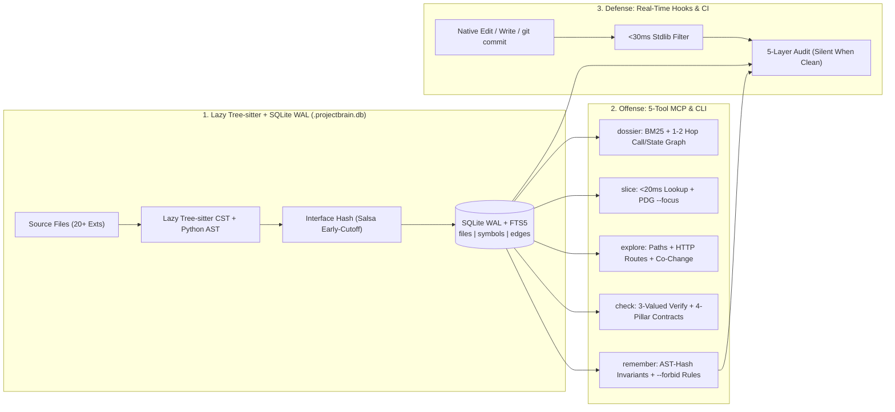

# ProjectBrain (`projectbrain-mcp` v1.2.0)

[](https://pypi.org/project/projectbrain-mcp/)
[](https://opensource.org/licenses/MIT)
[](https://www.python.org/downloads/)

**Zero-LSP SQLite Code Graph, `<8 KB` Inline MCP Context Compiler, Full-Stack Route Tracer & Sub-2s Contract Guardrail for AI Coding Agents.**

ProjectBrain gives Claude Code, Cursor, Antigravity, Windsurf, and CI pipelines both **Offense** (`<8 KB` zero-spillover architectural dossiers, `<20ms` surgical PDG + React monolith maps, and verb-agnostic `${baseUrl}` -> FastAPI/Express route tracing) and **Defense** (sub-2s batched `git cat-file --batch` contract checks, React hook & undeclared-setter AST detection, PR merge-base verification, Governance Tamper Lock, and SARIF v2.1.0) backed by a local SQLite WAL + FTS5 graph (`.projectbrain.db`) and lazy-loaded `tree-sitter` / Python `ast`. No LSP servers, no Docker, no cloud embeddings, and no API keys.

---

## What's New in v1.2.0 (Speed, Zero Spillovers & Full-Stack Precision)

1. **Strict `<8 KB` Inline MCP Payload Cap (`0` `output.txt` Double-Hop Spillovers):** Every MCP tool (`brain_explore`, `brain_dossier`, `brain_slice`, `brain_check`) strips internal 6D IR arrays/hashes, registers `structured_output=False` (eliminating duplicate FastMCP wire serialization), and enforces `<= 7,800` UTF-8 chars inline — preventing IDE `.system_generated/.../output.txt` file spillovers and extra `read_file` billing turns.
2. **React/JSX Monolith Internal Maps + `undeclared_state_setter` AST Gate:** Slicing 1,000–2,000+ line React components prepends a compact `[Monolith Internal Map]` indexing all `useState` pairs, `useEffect`/`useMemo` spans, interactive handlers, and JSX return bounds. `brain_check` now runs single-pass CST lexical binding verification (`Law 6`) to catch bare `setFoo(...)` typos/refactors (`ReferenceError` at runtime) and suggest the closest `[state, setState]` hook declaration.
3. **Dynamic `` `${baseUrl}/api/...` `` & Cross-File `include_router` Route Flows + `snake_case` <-> `camelCase` Lookup:** `brain_explore("/api/v1/...")` is now verb-agnostic (`GET`/`POST`/`PUT`/`DELETE`), resolves FastAPI `include_router(..., prefix=...)` and Express `app.use('/prefix', router)` mounts across files (including PEP 420 namespace packages), traces template-literal `fetch`/`axios`/wrapper callers, and matches `send_email` <-> `sendEmail` seamlessly.
4. **Sub-2s `brain_check` on Windows `stdio` (`git cat-file --batch` + Lock-Safe Thread Pool):** Replaces per-file `git show` subprocesses with a single `git cat-file --batch` stream (`<30ms`), caches `HEAD` baseline misses, switches MCP `stdio` indexing from `ProcessPoolExecutor` `spawn` to GIL-releasing `ThreadPoolExecutor` (eliminating 3-minute Windows `stdio` pipe hangs and prompt-cache TTL evictions), and guards concurrent MCP calls with per-repo reentrant locks.
5. **Small-Scope Direct-Read Discipline:** Built-in `direct_read_hint` and updated `AGENTS.md` rules explicitly steer agents to use native `rg` + `read_file` directly when a feature spans `<=6` files, a file is `<=350` lines, or a single React monolith is being audited end-to-end.

---

## Why ProjectBrain? (Offense + Team/CI Defense)

AI coding agents edit fast with native `Edit` / `edit_file` tools, but routinely **break uninspected callers across files**, **violate layer boundaries**, **silently delete governance rules in PRs**, or **burn 50k+ tokens** grep-crawling monoliths. ProjectBrain solves both without forcing agents to learn a custom edit DSL:

### 1. Defense: Active Real-Time Hooks, PR Merge-Base CI Gate & Governance Tamper Lock
Installed automatically by `projectbrain init` (or OS-portable `projectbrain init --team --learn` for git-shared team configs and `.github/workflows/projectbrain.yml`):
- **Silent When Clean (`0` Token Tax):** Non-code edits (`.md`, `.json`, `.toml`) exit in `<30ms` on a pure-stdlib fast path without importing Tree-sitter. Clean body-only code edits verify incrementally via Salsa early-cutoff and emit **zero bytes** (`exit 0`).
- **True PR Merge-Base Diffing (`check --base main` / Automatic CI PR Detection):** Audits committed multi-commit PR branches against `git merge-base` (auto-detecting `GITHUB_BASE_REF`, `CI_MERGE_REQUEST_TARGET_BRANCH_NAME`, Bitbucket, and Azure PR envs) even when the CI working tree is 100% clean — catching cross-file arity/return-key breaks, signature blast radius, broken imports from deleted/renamed files, stale invariants, and git co-change drift.
- **Governance Tamper Lock (`.projectbrain_memory.json`):** Compares `.projectbrain_memory.json` against the base branch and blocks `--ci` (`UNSAFE_GOVERNANCE_TAMPER`) if an agent deletes/weakens `--forbid` boundary rules, deletes/modifies AST invariants, wipes `ast_hash`, or removes `co_change_rules` without explicit human `--allow-governance-change`.
- **Zero-Config Day-1 Onboarding (`projectbrain learn` / `init --learn`):** Automatically discovers **zero-violation** directional layer `--forbid` boundaries (`routes/* -> db/*`, `db/* -> services/*`), mines high-confidence git co-change contracts, and ranks high-fan-in hub symbols on Day 1.
- **OASIS SARIF v2.1.0 & Zero-Noise Sticky PR Comments:** `--format sarif` emits Code Scanning SARIF (`PB001`–`PB010`); `--format pr-comment` emits sticky `<!-- projectbrain-pr-guardrail -->` Markdown (1-line green pass when clean; full Mermaid `graph LR` blast-radius diagram + covering test suite when impactful).

### 2. Offense: Lean 5-Tool Zero-LSP MCP & CLI Surface (`server.py`)
By default (`projectbrain-mcp --lean`), ProjectBrain exposes **5 non-overlapping power tools** so it never bloats the agent's tool-schema budget:

| MCP Tool / CLI Command | Purpose |
| :--- | :--- |
| **`brain_dossier`** (`projectbrain dossier`) | **1-Turn Architecture Compiler:** Ranks relevant files & symbols via sub-identifier BM25 + 1–2 hop call/import/state-flow edges, returning class-qualified code slices, neighbor skeletons, covering tests, and pinned invariants in `~0.2s`. |
| **`brain_slice`** (`projectbrain slice`) | **`<20ms` Surgical Symbol & PDG Slicer:** Reads exact functions, methods (`Class.method`, `res.send`), file skeletons, or intra-function **Program Dependence Graph (`--focus var`)** slices (`backward defs` + `forward uses` + `enclosing guards`) directly from SQLite. |
| **`brain_explore`** (`projectbrain explore`) | **Unified Code Graph Navigator:** Traces callers/callees, shortest call/import path between `target` and `target_b`, full-stack `/api/...` route flows, and git `co_changes`. |
| **`brain_check`** (`projectbrain check`) | **Pre-Flight Verifier, PR Merge-Base Gate & SARIF/PR Reporter:** Fact-checks 3-valued claims (`SUPPORTED` / `REFUTED` / `UNKNOWN`), audits working-tree or `--base <ref>` PR diffs, enforces Governance Tamper Lock, and outputs `text`, `json`, `markdown`, `pr-comment`, `github`, or `sarif`. |
| **`brain_remember`** (`projectbrain remember` / `memories`) | **Git-Tracked Repo Governance (`.projectbrain_memory.json`):** Pins symbol invariants anchored to normalized AST hashes, `--forbid "<src_glob> -> <dst_glob>"` layer rules, and `--co-change "<file_a> <-> <file_b>"` coupling contracts. |

*(Pass `--full` or `PROJECTBRAIN_FULL_TOOLS=1` to also expose auxiliary tools: `brain_learn`, `brain_context`, `brain_stats`, `brain_run`, `brain_patch`.)*

---

## Quick Start (60 Seconds)

### 1. Install (`uv` Recommended — Zero PEP 668 Friction)

```bash
# Recommended: isolated global CLI + MCP binaries via uv (or pipx)
uv tool install projectbrain-mcp

# Alternative: pipx
pipx install projectbrain-mcp

# Or inside an active Python virtual environment:
pip install projectbrain-mcp
```

### 2. Initialize Your Repository (Local or OS-Portable Team + CI Mode)

```bash
# Personal / local workstation setup (ENOENT-proof absolute IDE paths):
projectbrain --path /path/to/your/repo init --git-hook

# Team + CI setup (OS-portable .claude/settings.json, .cursor/hooks.json, GitHub Action, & Day-1 rule discovery):
projectbrain --path /path/to/your/repo init --team --learn
```

What `init` sets up non-destructively:
1. Indexes your repository into `.projectbrain.db` (SQLite WAL + FTS5) honoring `.gitignore` and `.git/info/exclude`.
2. Writes `.mcp.json` and non-destructive `<!-- projectbrain:start -->` workflow rules in `AGENTS.md` (with `--team`, emits zero local user/workspace paths so `.claude/settings.json`, `.cursor/hooks.json`, and `.github/workflows/projectbrain.yml` commit cleanly across macOS/Linux/Windows).
3. Optionally runs `learn` (`--learn`) to auto-discover zero-violation `--forbid` layer boundaries and git co-change contracts into `.projectbrain_memory.json`.
4. Keeps `.projectbrain.db` git-ignored while leaving `.projectbrain_memory.json` git-trackable and Tamper-Locked across PRs.

### 3. MCP Server Configuration (or Zero-Install via `uvx`)

```json
{
  "mcpServers": {
    "projectbrain": {
      "command": "uvx",
      "args": ["--from", "projectbrain-mcp", "projectbrain-mcp", "--lean", "/path/to/your/repo"]
    }
  }
}
```

### 4. Core CLI Workflow

```bash
# 1. Auto-discover zero-violation architectural boundaries, co-change rules & hub symbols (dry-run or --apply)
projectbrain --path /path/to/repo learn
projectbrain --path /path/to/repo learn --apply

# 2. Compile a 1-turn architecture dossier or <20ms PDG variable slice
projectbrain --path /path/to/repo dossier "how are exceptions routed to error handlers"
projectbrain --path /path/to/repo slice billing.py:compute_invoice --focus discount_total

# 3. Pin an enforceable boundary rule, co-change contract, or AST symbol invariant (git-tracked)
projectbrain --path /path/to/repo remember --forbid "routes/* -> db/*" --reason "Routes must go through services/*"
projectbrain --path /path/to/repo remember --co-change "schema.sql <-> models/user.py" --reason "Keep ORM synced"
projectbrain --path /path/to/repo remember settle_invoice "Must remain idempotent on duplicate invoice_id"

# 4. Run PR merge-base contract, boundary & governance tamper gate (text, pr-comment, sarif, or --ci)
projectbrain --path /path/to/repo check --base main --ci
projectbrain --path /path/to/repo check --base main --format pr-comment
projectbrain --path /path/to/repo check --base main --format sarif > projectbrain.sarif

# 5. View regression interception & code-graph scorecard
projectbrain --path /path/to/repo stats --summary
```

### 5. `<2s` GitHub Actions CI / PR Guardrail

```yaml
name: ProjectBrain Architecture & Contract Gate
on: [pull_request]
jobs:
  guardrail:
    runs-on: ubuntu-latest
    steps:
      - uses: actions/checkout@v4
        with:
          fetch-depth: 0
      - uses: astral-sh/setup-uv@v4
      - name: Verify cross-file contracts, boundaries & blast radius
        run: uvx --from projectbrain-mcp projectbrain check --ci
```

---

## System Architecture



---

## Honest Tradeoffs, Limitations & When to Use `rg`

ProjectBrain is a deterministic static AST + lexical/graph engine, **not** an embedding model or runtime tracer:

1. **When plain `rg` + `read_file` is better:** If you already know an exact literal string, if the repo/feature touches `<=6` well-named files, if a file is `<=350` lines (`<=12 KB`), or if you are auditing a single giant React JSX monolith component end-to-end, native `rg` + `read_file` in 1 turn beats adding a code-graph middleman — then run `brain_check` once at the end as a `<2s` cross-file & hook contract gate.
2. **Lexical + Graph Ranking vs. Embeddings (`dossier`):** Indexing takes `~0.1–1.5s` locally with zero API keys or model downloads. If a query uses completely different words from the codebase's identifiers and docstrings (naming zero symbols), lexical ranking can miss entry points until you supply a domain term.
3. **Static Analysis vs. Dynamic Dispatch (`verify` / `check`):** Calls through runtime-assigned variables (`adapter = self.get_adapter(url); adapter.send(req)`) cannot be proven to hit a single concrete class statically. `dossier` surfaces candidate edges (`send -> HTTPAdapter.send`), while `verify` honestly returns **`UNKNOWN`** rather than fabricating a false `REFUTED` or `SUPPORTED`.
4. **Language Tier Depth:**
   - **Tier 1 (Python, TypeScript/JavaScript):** Full AST/CST parsing (CommonJS, prototypes, `@typing.overload` dedup), intra-function PDG `--focus` slicing, relative/barrel/`tsconfig` alias resolution, route inference (FastAPI, Flask, Django, Next.js, Express, Hono), and 4-pillar cross-file contract verification.
   - **Tier 2 (Go, Rust, Java, Kotlin, C/C++, C#, Ruby, PHP):** Tree-sitter structural symbol extraction, call/import graph edges, CST PDG slicing (`.go`, `.rs`, `.java`), skeletons, and boundary/syntax guardrails.
   - **Tier 3 (SQL, GraphQL, Prisma, Protobuf, Vue/Svelte, Scala, Swift):** DDL table/column/`NOT NULL` constraint extraction, schema-to-code linking, SFC script extraction, and symbol/line slicing.

---

## Reproducible Benchmarks (`projectbrain/eval/`)

All evaluation scripts are checked into [`projectbrain/eval/`](projectbrain/eval/) and enforced in CI:

```bash
# 1. Fixture regression guards, self-dogfooding, and zero-ID adversarial evaluation
python projectbrain/eval/run_eval.py

# 2. 200-file polyglot scale, incremental Salsa early-cutoff, FTS5, and recursive CTE latency benchmark
python projectbrain/eval/bench_scale.py

# 3. External repository benchmarks: pallets/flask, django/django, psf/requests, pallets/click, expressjs/express
python projectbrain/eval/bench_external.py --suite all

# 4. Full unit, guardrail, anti-leakage, security, and regression test suite (260 tests)
pytest projectbrain/tests -q
```

### 1. Held-Out External Repository Benchmark (`python projectbrain/eval/bench_external.py --suite heldout`)

| Repository | Dossier Questions | Target Symbol Slice Recall | Cost per Hit | Structural & Slicing Checks |
| :--- | :---: | :---: | :---: | :--- |
| **`psf/requests`** | 4 questions (`proxies`, `redirects/auth`, `cookies`, `adapters/pool`) | **`15 / 15` (`100%`)** | `3.99 KB` | `verify_claim("Session.send", "calls", "HTTPAdapter.send")` -> **`UNKNOWN`** (dynamic receiver `adapter.send`, never false `REFUTED`); `slice_symbols(["should_strip_auth", "get_environ_proxies"])` -> `2 / 2` |
| **`pallets/click`** | 3 questions (`option/arg parsing`, `Group subcommand dispatch`, `ParamType converters`) | **`11 / 11` (`100%`)** | `4.35 KB` | **`0` bare `__init__` headers** (all methods qualified as `ClassName.method`, e.g. `Group.invoke`, `Group.resolve_command`, `ParamType.convert`) |
| **`expressjs/express`** | 3 questions (`res.send content-type`, `app.use mounting`, `app.handle dispatch`) | **`6 / 6` (`100%`)** | `2.81 KB` | `lib/response.js`: **32 functions** indexed; `lib/application.js`: **18 functions** indexed; `slice_symbols(["res.send", "app.use", "app.handle"])` -> **`3 / 3`** |
| **Combined Held-Out Total** | **10 questions** | **`32 / 32` (`100%`)** | **`3.89 KB`** | — |

### 2. Scale & Incremental Latency (`pallets/flask` & `django/django`)

| Benchmark | Result |
| :--- | :---: |
| **`pallets/flask` (6 Architectural Questions) — Target Function Slice Recall** | **`21 / 21` (`100%`)** (`2.66 KB` / hit) |
| **`django/django` (`3,051` files) — Single-File Body Edit `incremental_index()`** | **`~515 ms`** (`salsa_early_cutoff: True`) |
| **`django/django` (`3,051` files) — Single-File Signature Edit `incremental_index()`** | **`~894 ms`** (`O(Δ)` subgraph update) |
| **Cold Python Import (`from projectbrain.brain import ProjectBrain`)** | **`~150 ms`** (`3.15x` faster via lazy Tree-sitter C grammar loading) |
| **Non-Code Hook Bailout (`projectbrain hook post-edit` on `.md` / `.json`)** | **`< 30 ms`** (pure stdlib fast-path, `0` bytes emitted) |

### 3. Built-In Verification, Self-Dogfood & Adversarial Suite (`python projectbrain/eval/run_eval.py`)

| Suite | Scope | Metric | Result |
| :--- | :--- | :--- | :---: |
| **File Localization (`eval/tasks.json`)** | Fixture repos (10 tasks) | Precision / Recall | **`100%` / `100%`** |
| **Multi-Hop Graph vs. Grep (`eval/relationship_tasks.json`)** | Fixture repos (8 tasks, incl. negative controls) | Pass Rate | **`8 / 8` (`100%`)** |
| **Closed-World Claim Verification (`eval/claim_tasks.json`)** | Fixture repos (22 tasks) | Exact Verdict Accuracy | **`22 / 22` (`100%`, `0` false refutations)** |
| **Self-Dogfooding (`compile_context`)** | ProjectBrain repo (3 tasks, 6 target symbols) | Symbol Recall | **`100%` (`6 / 6` symbols)** |
| **Adversarial Zero-Identifier (`compile_context`)** | ProjectBrain repo (4 tasks, 8 target symbols; zero function names in prompt) | Symbol Recall | **`87.5%` (`7 / 8` symbols vs `50.0%` for disciplined `grep`)** |
