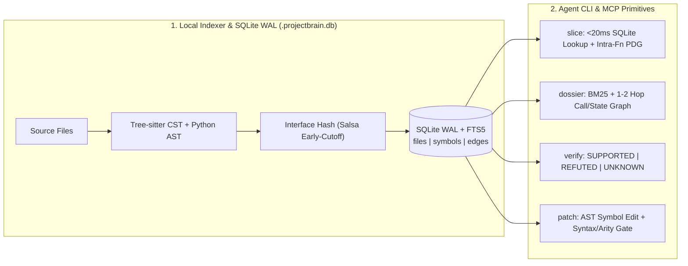

# ProjectBrain (`projectbrain-mcp` v0.8.10)

[](https://pypi.org/project/projectbrain-mcp/)
[](https://opensource.org/licenses/MIT)
[](https://www.python.org/downloads/)

**Local SQLite Code Graph, Program Slicer, and Syntax-Verified Symbol Patcher for AI Coding Agents.**

ProjectBrain is a local static-analysis and code-slicing tool backed by SQLite (`.projectbrain.db`, WAL + FTS5) and `tree-sitter` / Python `ast`. It requires no external database server, no Docker, no cloud embeddings, and no API keys.

It exposes four concrete primitives to CLI and MCP coding agents:

1. **`slice` (`projectbrain slice` / `brain_slice`):** Reads exact functions, classes, methods, CommonJS/prototype assignments (`res.send`, `app.use`), or line ranges (`file.py:Class.method` or `file.py:120-160`) from SQLite in `< 20ms` without loading full files into the context window. For long functions sliced around a target variable or call, it computes an intra-function Program Dependence Graph (PDG) slice (`backward defs` + `forward uses` + `enclosing control guards`).
2. **`dossier` (`projectbrain dossier` / `brain_dossier`):** Given a natural-language question or bug report, ranks relevant symbols using sub-identifier BM25 + call/import/state-flow graph edges and compiles a single-turn markdown packet containing class-qualified (`ClassName.method`) code slices and 1-hop caller/callee coordinates in `~0.2s`.
3. **`patch` (`projectbrain patch` / `brain_patch`):** Applies symbol-anchored edits (`@replace_body <Symbol>`, `@add_method <ClassName>`, `@replace <Symbol>`, `@sub <Symbol>`) validated in memory against language syntax compilers (`compile()` / Tree-sitter `ERROR` nodes) and caller arity contracts before touching disk. Broken edits are rejected with zero bytes changed on disk.
4. **`verify` (`projectbrain verify` / `projectbrain_verify_claim`):** Checks structural claims (`calls`, `reaches`, `imports`, `handles`) against the static call/import graph, returning `SUPPORTED`, `REFUTED`, or `UNKNOWN`. It refuses to guess (`UNKNOWN`) when a traversed file has syntax errors or when a call goes through a dynamic local variable receiver (`adapter.send(request)`) whose runtime type cannot be proven statically.

---

## System Architecture

### 1. Indexing & Incremental Update Pipeline (`parsers.py`, `graph.py`, `store.py`)

```text
Repository Files (.py, .ts/.js, .go, .rs, .java, .sql, ...)
  │
  ├─► 1. Fast Directory Walk (_walk_entries)
  │     • Compiles non-negated .gitignore & .git/info/exclude rules into union regexes
  │     • Skips vendored/minified bundles and tracks (mtime, size) per file
  │
  ├─► 2. AST / CST Extraction (parsers.py)
  │     • Python: `ast` + Tree-sitter (functions, classes, methods, calls, state reads/writes,
  │       routes, SQL strings; filters @typing.overload stubs)
  │     • JS/TS: Tree-sitter CST (ES6 classes/functions, CommonJS `obj.method = function`,
  │       chained `a.b = a.c = fn`, `Class.prototype.m = fn`, `defineGetter`, `require()`)
  │     • Computes per-file `interface_hash` over exported signatures, bases, and imports
  │
  ├─► 3. Typed Code Graph & SQLite WAL Persistence (graph.py, store.py)
  │     • Nodes: `file:`, `cls:`, `fn:`, `route:`
  │     • Edges: `defines`, `has_method`, `inherits`, `imports`, `calls`
  │              (`exact` | `import_resolved` | `candidate`), `state_flow`, `http_flow`
  │     • Stored in `.projectbrain.db` (SQLite WAL + FTS5 tables: `files`, `symbols`, `edges`)
  │
  └─► 4. Incremental Edit Loop (incremental_index)
        • Unchanged mtime/size ──────────────────────► No-op (< 200ms on 3,000-file repo)
        • Body-only edit (interface_hash unchanged) ─► Salsa Early-Cutoff (~515ms on Django):
                                                       updates single file's AST & local edges
        • Signature/import edit ─────────────────────► O(Δ) Subgraph Update (~895ms on Django):
                                                       re-resolves only affected importers/callers
```

### 2. Query, Slicing, Verification & Patching Pipeline (`brain.py`, `slicer.py`, `patcher.py`)

```text
Agent CLI / MCP Request
  │
  ├──► `slice <Symbol>` (slicer.py)
  │      ├─► Cold fast-path: queries SQLite `symbols` table directly (< 20ms)
  │      └─► If focus variable/call & span > max_lines:
  │            Runs AST/CST PDG Slicer (`_analyze_python_ast_pdg` / `_analyze_treesitter_cst_pdg`)
  │            Emits `# [PDG Slice: seeds=L.. | bwd_defs=L.. | fwd_uses=L.. | guards=L..]`
  │
  ├──► `dossier "<question>"` (brain.py)
  │      ├─► Step 1: Extract explicit symbols/paths/constants (`res.send`, `SECRET_KEY`)
  │      ├─► Step 2: Score files & functions via sub-identifier BM25/IDF + cross-file caller centrality
  │      ├─► Step 3: Expand 1–2 hop `calls` & `state_flow` neighbors via submodular token gain
  │      └─► Step 4: Fold multi-line docstrings (>3 lines) + apply PDG slicing within line budget
  │
  ├──► `verify "<subj>" <rel> "<obj>"` (brain.py)
  │      ├─► Direct `exact` / `import_resolved` edge found ───► `SUPPORTED` (with file:line evidence)
  │      ├─► Syntax error (`parse_status == "partial"`)
  │      │   or dynamic receiver (`adapter.send(req)`) ───────► `UNKNOWN` (explains static limit)
  │      └─► Clean parse + complete static call set checked ──► `REFUTED`
  │
  └──► `patch --apply` (patcher.py)
         ├─► Resolves target symbol span (`Class.method` / `obj.method`) in current AST
         ├─► Applies `@replace_body` / `@add_method` / `@replace` / `@sub` in memory
         ├─► Validates syntax (`compile()` / Tree-sitter `ERROR` check) + caller argument arity
         └─► Valid ──► Atomic write + incremental re-index | Invalid ──► Reject (file untouched)
```



---

## Honest Tradeoffs, Limitations & When to Use `grep`

ProjectBrain is a static AST + lexical/graph tool, **not** an embedding model or runtime tracer. Knowing its exact boundaries will save you time:

1. **When plain `rg` / `grep` is better:**
   - If you already know the exact literal string, error message, or constant name and just want matching line numbers, `rg` is faster and simpler.
2. **Where `slice` and `patch` are strongest:**
   - `slice` is the sharpest primitive in the package: once you have a function or method name (`should_strip_auth`, `Query.build_filter`, `res.send`), it returns the exact symbol body with zero surrounding file noise.
   - `patch` prevents line-number drift and syntax corruption by anchoring edits to symbol names and rejecting broken syntax before writing to disk.
3. **Lexical + Graph Ranking vs. Embeddings (`dossier`):**
   - `dossier` ranks files and symbols using camelCase/snake_case sub-identifier BM25, participle stemming, cross-file caller centrality, and 1–2 hop graph traversal.
   - **Tradeoff:** Indexing takes `~0.1–1.5s` locally with zero API keys or GPU/embedding downloads. However, if a natural-language prompt uses completely different vocabulary from the codebase's identifiers and docstrings (and names zero symbols), lexical entry-point ranking can miss functions until you supply a closer domain term.
4. **Static Analysis vs. Dynamic Dispatch (`verify`):**
   - In Python and JavaScript, calls through local variables assigned at runtime (e.g., `adapter = self.get_adapter(url); adapter.send(request)` in `psf/requests`) cannot be resolved to a single concrete class without runtime type tracing.
   - In `dossier`, ProjectBrain surfaces candidate call edges (`send -> HTTPAdapter.send @L784`) for exploration. In `verify`, ProjectBrain returns **`UNKNOWN`** (citing the dynamic receiver `adapter`) rather than guessing `SUPPORTED` or falsely returning `REFUTED`.
5. **Language Tier Depth:**
   - **Tier 1 (Python, JS/TS)** has full AST/CST parsing, CommonJS/prototype assignment indexing, intra-function PDG slicing, cross-file import resolution, and arity contract checks.
   - **Tier 2 (Go, Rust, Java, Kotlin, C/C++, C#, Ruby, PHP)** and **Tier 3 (SQL, GraphQL, Prisma, Protobuf, Vue/Svelte)** use Tree-sitter structural queries for symbol indexing, call edges, slicing, and syntax-checked patching, but have lighter framework/state-flow heuristics than Tier 1.

---

## Language-Support Tiers

| Tier | Languages / Formats | Capabilities |
| :--- | :--- | :--- |
| **Tier 1: Deep AST + PDG + Contracts** | **Python** (`.py`), **TypeScript / JavaScript** (`.ts`, `.tsx`, `.js`, `.jsx`, `.mjs`, `.cjs`) | Full Tree-sitter + Python `ast` parsing (including CommonJS `obj.method = function`, chained assignments, `Class.prototype.method`, `exports.foo`, `defineGetter`, and `@typing.overload` stub deduplication); intra-function PDG data/control-dependence slicing (`def -> use` + enclosing guards); cross-file relative import, `require('./mod')`, & `tsconfig` path-alias resolution; class/module config & descriptor tracking (`ConfigAttribute`, `Field`, `Column`, constants); route extraction (Flask, FastAPI, Django, Next.js, Express, Hono); caller arity & SQL schema contract checks. |
| **Tier 2: Tree-sitter Structural + Call Graph** | **Go** (`.go`), **Rust** (`.rs`), **Java** (`.java`), **Kotlin** (`.kt`), **C / C++** (`.c`, `.h`, `.cpp`, `.hpp`), **C#** (`.cs`), **Ruby** (`.rb`), **PHP** (`.php`) | Structural symbol extraction (functions, methods, structs, classes, interfaces, traits); intra-file and cross-file call/import graph edges; Intra-function CST PDG slicing (`.go`, `.rs`, `.java`); signature skeletons; symbol & line-range slicing; syntax-verified symbol patching. |
| **Tier 3: Schema, Query & Component Indexing** | **SQL** (`.sql`), **GraphQL** (`.graphql`, `.gql`), **Prisma** (`.prisma`), **Protobuf** (`.proto`), **Vue / Svelte** (`.vue`, `.svelte`), **Scala** (`.scala`), **Swift** (`.swift`) | DDL table/column/constraint extraction (`CREATE TABLE`, `NOT NULL`), schema-to-code linking, component script extraction, and symbol/line slicing. |

---

## Quick Start

### 1. Install

```bash
pip install "projectbrain-mcp>=0.8.10"
```

### 2. Initialize a Repository (Minimal & Non-Destructive)

```bash
projectbrain --path /path/to/your/repo init
```

- **Honors `.gitignore`:** Respects root and nested `.gitignore` and `.git/info/exclude` rules.
- **Minimal Default Setup (`--ide auto`):** Creates `.projectbrain.db` (SQLite WAL), updates `.gitignore`, and writes `.mcp.json` and `AGENTS.md` at the repo root using non-destructive `<!-- projectbrain:start --> ... <!-- projectbrain:end -->` markers. Only writes `.cursor/`, `.vscode/`, or `.claude/` configs if those directories already exist in your repository (or when `--ide all` / `--ide claude` is explicitly passed).
- **Safe Execution Defaults:** Direct shell execution over MCP (`brain_run`) is disabled by default unless explicitly opted in via `PROJECTBRAIN_ALLOW_EXEC=1`.

### 3. MCP Server Configuration

```json
{
  "mcpServers": {
    "projectbrain": {
      "command": "projectbrain-mcp",
      "args": ["--lean", "/path/to/your/repo"]
    }
  }
}
```

### 4. Core CLI Commands

```bash
# 1. Slice exact symbols or line ranges (fast <20ms SQLite lookup on indexed repos)
projectbrain --path /path/to/repo slice Query.build_filter res.send should_strip_auth

# 2. Compile a 1-turn code dossier (target slices + callers + callees)
projectbrain --path /path/to/repo dossier "how are exceptions routed to error handlers"

# 3. Apply a syntax-verified, symbol-anchored patch (--apply to write, omit for dry-run diff)
projectbrain --path /path/to/repo patch --apply --spec-file patch.spec

# 4. Verify closed-world structural claims (calls, reaches, imports, handles)
projectbrain --path /path/to/repo verify "Session.send" calls "HTTPAdapter.send"
```

---

## Reproducible Benchmarks (`projectbrain/eval/`)

All evaluation scripts are checked into [`eval/`](eval/) and can be run from the repository root:

```bash
# 1. Fixture regression guards, self-dogfooding, and zero-ID adversarial evaluation
python projectbrain/eval/run_eval.py

# 2. 200-file polyglot scale, incremental Salsa early-cutoff, FTS5, and recursive CTE latency benchmark
python projectbrain/eval/bench_scale.py

# 3. External repository benchmarks: pallets/flask, django/django, psf/requests, pallets/click, expressjs/express
python projectbrain/eval/bench_external.py --suite all

# 4. Full unit, integration, security, and regression test suite (202 tests)
pytest projectbrain/tests -q
```

### 1. Held-Out External Repository Benchmark (`python projectbrain/eval/bench_external.py --suite heldout`)

Evaluated on real clones of `psf/requests`, `pallets/click`, and `expressjs/express` (10 architectural dossier questions across 32 target symbols, plus `slice` and `verify` checks):

| Repository | Dossier Questions | Target Symbol Slice Recall | Cost per Hit | Structural & Slicing Checks |
| :--- | :---: | :---: | :---: | :--- |
| **`psf/requests`** | 4 questions (`proxies`, `redirects/auth`, `cookies`, `adapters/pool`) | **`15 / 15` (`100%`)** | `3.71 KB` | `verify_claim("Session.send", "calls", "HTTPAdapter.send")` -> **`UNKNOWN`** (dynamic receiver `adapter.send`, never false `REFUTED`); `slice_symbols(["should_strip_auth", "get_environ_proxies"])` -> `2 / 2` |
| **`pallets/click`** | 3 questions (`option/arg parsing`, `Group subcommand dispatch`, `ParamType converters`) | **`9 / 11` (`81.8%`)** *(misses `consume_value`, `process_value` on Q1)* | `4.95 KB` | **`0` bare `__init__` headers** (all methods qualified as `ClassName.method`, e.g. `Group.invoke`, `Group.resolve_command`, `ParamType.convert`, `Parameter.type_cast_value`) |
| **`expressjs/express`** | 3 questions (`res.send content-type`, `app.use mounting`, `app.handle dispatch`) | **`6 / 6` (`100%`)** | `2.34 KB` | `lib/response.js`: **32 functions** indexed; `lib/application.js`: **18 functions** indexed; `slice_symbols(["res.send", "app.use", "app.handle"])` -> **`3 / 3`** |
| **Combined Held-Out Total** | **10 questions** | **`30 / 32` (`93.8%`)** | **`3.81 KB`** | — |

### 2. Iterated External Repository Benchmarks (`pallets/flask` & `django/django`)

*(`pallets/flask` and `django/django` were used during `v0.8.5`–`v0.8.8` development to tune dossier token budgets, PDG slicing, and incremental indexing latency.)*

| Benchmark | `v0.8.4` | `v0.8.6` | `v0.8.10` |
| :--- | :---: | :---: | :---: |
| **`pallets/flask` (6 Architectural Questions) — Target Function Slice Recall** | `9 / 19` (`47.4%`) | `12 / 19` (`63.2%`) | **`21 / 21` (`100%`, `19 / 19` subset)** |
| **`pallets/flask` (6 Architectural Questions) — Total Dossier Output** | `68.0 KB` | `113.0 KB` | **`55.8 KB` (`-50.6%` vs `v0.8.6`)** |
| **`pallets/flask` (6 Architectural Questions) — Cost per Correct Hit** | `7.6 KB` | `9.4 KB` | **`2.66 KB`** |
| **`pallets/flask` — End-to-End Bug-Fix (`dossier` -> `slice` -> `patch` -> `test`)** | — | — | **`PASS` (`red -> green` in `1.51 s`, `0` syntax/contract errors)** |
| **`django/django` (`3,051` files) — Cold `brain.load()` / Cold Walk Latency** | ~8,300 ms / 820 ms | ~8,300 ms / 820 ms | **`~4,400 ms` / `~245 ms`** |
| **`django/django` (`3,051` files) — Single-File Edit `incremental_index()` Latency** | ~7,000 ms (global rebuild) | ~7,000 ms (global rebuild) | **`515 ms` body edit (`salsa_early_cutoff: True`) / `894 ms` interface edit** |

### 3. Built-In Verification, Self-Dogfood & Adversarial Suite (`python projectbrain/eval/run_eval.py`)

| Suite | Scope | Metric | Result | Honest Comparison vs. Disciplined `grep` |
| :--- | :--- | :--- | :---: | :--- |
| **File Localization (`eval/tasks.json`)** | Small fixture repos (10 tasks) | Precision / Recall | **`100%` / `100%`** | Regression guard on basic file ranking (most are directly grep-answerable) |
| **Multi-Hop Graph vs. Grep (`eval/relationship_tasks.json`)** | Small fixture repos (8 tasks, incl. negative controls) | Pass Rate | **`8 / 8` (`100%`)** | Tests 2-hop call paths where single-file `grep` misses the intermediate module |
| **Closed-World Claim Verification (`eval/claim_tasks.json`)** | Small fixture repos (22 tasks) | Exact Verdict Accuracy | **`22 / 22` (`100%`)** | `0` false supports, `0` false refutations; returns `UNKNOWN` on syntax-broken files |
| **Self-Dogfooding (`compile_context`)** | ProjectBrain repo (3 tasks, 6 target symbols) | Symbol Recall & Token Savings | **`100%` (`6 / 6` symbols)** | **`22.2%–29.9%` fewer tokens** than disciplined `grep + 120-line windows` (`93.1%–97.6%` vs full files); `grep` recall is `100%` on 2 tasks and `0%` on 1 task |
| **Adversarial Zero-Identifier (`compile_context`)** | ProjectBrain repo (4 tasks, 8 target symbols; zero function names in prompt) | Symbol Recall & Token Savings | **`87.5%` (`7 / 8` symbols)** | `100%` recall on 3 tasks and `50%` on 1 task vs **`50.0%` (`4 / 8`)** for disciplined `grep`; token delta vs `grep` ranges from `-6.0%` to `+26.4%` |
