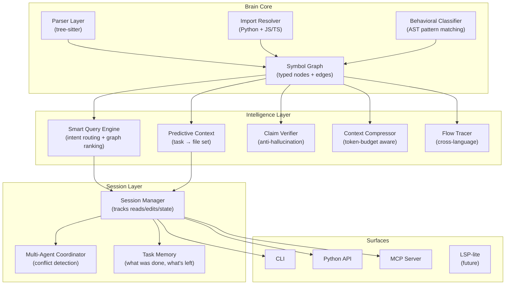

# Project Brain: Product Vision

## What Exists Today (And What Doesn't)

Here's every tool in this space, what they actually do, and the gap Brain can own.

| Tool | What It Does | What It Doesn't Do |
|---|---|---|
| **Aider repo-map** | PageRank on a file→symbol graph, fits a structural skeleton into a token budget. Rebuilt per session. | No persistent state. No querying. No relationships. No memory of what the agent already read. |
| **CodeGraph** | Tree-sitter → SQLite graph, exposed via MCP. Local-first. | Static snapshot. No session awareness. No behavioral understanding. No cross-language tracing. |
| **CKB** | SCIP + LSP + git heuristics. 80+ queries (impact, call graphs, affected tests). | Requires SCIP indexers per language. Heavy. Enterprise-oriented. Not agent-session-aware. |
| **Sourcegraph** | Enterprise code search + code intel. Cross-repo navigation. | Cloud/self-hosted. Not local-first. Not agent-native. Massive infra. |
| **Cursor indexing** | Embeddings + incremental sync. Semantic search via RAG. | Locked inside Cursor. Not a standalone tool. Opaque. No graph. |
| **Greptile** | Full-codebase reasoning API. | Cloud-only. Not local. Not open. |
| **Brain (today)** | Tree-sitter graph + typed edges + confidence + import resolution + MCP + verify_claim. | Query engine is keyword-only. No session state. No git layer. No cross-language flow. |

### The Gap Nobody Owns

Every tool above is either:
- **A snapshot** (indexes the code, answers one question, forgets everything) — Aider, CodeGraph
- **Enterprise infra** (powerful but requires deployment, not `pip install`) — Sourcegraph, CKB
- **Locked to one product** (can't use it with a different agent) — Cursor, Greptile

**Nobody has built a local-first, agent-native intelligence layer that maintains state across an entire coding session, understands code behavior (not just structure), and works with any agent.**

That's Brain's product.

---

## The 7 Features That Don't Exist Anywhere

### 1. Stateful Agent Sessions

**What it is**: Brain runs as a persistent sidecar process. When an agent starts a task, Brain opens a *session*. Every file the agent reads, every edit it makes, every query it asks — Brain remembers within the session.

**Why nobody does this**: Every existing tool treats each query as independent. Aider rebuilds its repo map per chat. CodeGraph answers queries statelessly. CKB has no concept of "what the agent already knows."

**What it enables**:

```python
session = brain.start_session(task="add discount code to checkout")

# First query — agent doesn't know the codebase yet
r1 = session.query("where is checkout handled?")
# → Returns CheckoutService.ts, checkout route, CouponModel.ts

# Agent reads CheckoutService.ts
session.mark_read("src/services/CheckoutService.ts")

# Second query — Brain knows what the agent already has
r2 = session.query("what else do I need?")
# → Returns ONLY CouponModel.ts and the route file
# → Doesn't re-suggest CheckoutService.ts
# → Adds: "You've read the service but not the model it imports"

# Agent edits CheckoutService.ts
session.mark_modified("src/services/CheckoutService.ts", diff="...")

# Third query
r3 = session.query("what might break?")
# → Impact analysis scoped to what was actually changed
# → "3 files import CheckoutService: PaymentPage.tsx, OrderSummary.tsx, tests/checkout.test.ts"
```

**Why this matters**: An agent that reads 40 files per task is wasting 70% of its context window on files it already saw or doesn't need. Session state turns Brain from "a tool the agent queries" into "a teammate that tracks the agent's progress."

> [!IMPORTANT]
> This is the single biggest differentiator. No tool in the market does this. It turns Brain from a static index into a **live collaborator**.

---

### 2. Predictive Context ("Here's What You'll Need")

**What it is**: Before the agent asks anything, Brain pre-computes a "context package" — the predicted set of files, line ranges, and reading order for a given task.

**Two triggers**:

#### A) Task-based prediction
```python
ctx = brain.predict("add discount code to checkout")
# Returns:
# {
#   "predicted_files": [
#     {"path": "src/routes/checkout.ts", "read_lines": [12, 58], "reason": "defines POST /checkout"},
#     {"path": "src/services/CheckoutService.ts", "read_lines": [1, 120], "reason": "handles checkout logic"},
#     {"path": "src/models/Coupon.ts", "read_lines": [1, 45], "reason": "coupon model, likely needs new field"},
#   ],
#   "predicted_new_files": ["src/validators/discountCode.ts"],
#   "read_order": ["route → service → model → new validator"],
#   "estimated_tokens": 3200,
#   "confidence": "high"
# }
```

#### B) Diff-based prediction
```python
ctx = brain.predict_from_diff(git_diff_string)
# "You changed the Coupon model's schema.
#  Files that will likely need updating:
#  - CheckoutService.ts (imports Coupon, uses coupon.validate())
#  - tests/checkout.test.ts (tests Coupon integration)
#  - src/types/checkout.d.ts (Coupon type definition)
#  Confidence: high (all connections are import_resolved)"
```

**How it works internally**:
1. Query-type routing (route query? component query? model query?) identifies entrypoint nodes
2. Graph BFS from entrypoints with depth limits
3. Heuristic: if the task says "add X to Y", predict a new file will be needed
4. Token estimation from cached file sizes + line ranges
5. Read-order from topological sort of the subgraph (dependencies first)

**What makes this different from Aider's repo-map**: Aider builds a PageRank-weighted skeleton of the whole repo and hopes the LLM figures out what's relevant. Brain **tells the agent exactly which files to read, in what order, and which line ranges matter** — and explains why.

---

### 3. Cross-Language Flow Tracing

**What it is**: In a real app, a single user action crosses language boundaries:

```
React button click
  → fetch("/api/checkout", { method: "POST" })
    → Express route: app.post("/api/checkout", handler)
      → CheckoutService.processOrder()
        → db.query("INSERT INTO orders ...")
```

That's JSX → HTTP → JS → Python/SQL. No existing local tool traces this as a single path.

**How Brain can do it**:

```python
flow = brain.trace_flow("/api/checkout", method="POST")
# Returns the complete chain:
# [
#   {type: "ui_trigger", file: "CheckoutPage.tsx", line: 42, code: "fetch('/api/checkout', ...)"},
#   {type: "route", file: "routes/checkout.ts", line: 12, code: "app.post('/api/checkout', ...)"},
#   {type: "handler", file: "services/checkout.ts", line: 30, code: "processOrder()"},
#   {type: "data", file: "models/Order.ts", line: 15, code: "db.insert(...)"},
# ]
```

**Implementation**:
- The parser already extracts routes (Express, FastAPI, Flask, Django, Next.js)
- Add: extract `fetch()` / `axios` / `http` calls from frontend code and match URL patterns to known routes
- Add: extract SQL/ORM calls from backend code and link them to model nodes
- The graph already has the edges — this is a specialized traversal that crosses the frontend↔backend boundary via URL matching

---

### 4. Anti-Hallucination Guard (Expand `verify_claim`)

**What it is**: Brain already has `verify_claim` — no other tool in the market has anything like it. But right now it only verifies structural claims ("does A call B?"). Expand it into a full **agent fact-checker**.

```python
# Agent says: "I'll modify getUserProfile in auth.ts to fix the login bug"
brain.verify_claim("auth.ts", "defines", "getUserProfile")
# → REFUTED: getUserProfile is defined in userService.ts, not auth.ts
# → Agent avoids editing the wrong file

# Agent says: "The checkout route calls validateCoupon"
brain.verify_claim("POST /checkout", "reaches", "validateCoupon")
# → SUPPORTED (via: checkout route → handler → CheckoutService.process → validateCoupon)
# → Evidence: [edge chain with confidence levels]

# Agent says: "Changing User model won't affect checkout"
brain.verify_claim("User", "reaches", "CheckoutService")
# → REFUTED: User → imported by AuthMiddleware → used by checkout route
# → "Your change WILL propagate to checkout through auth"
```

**The vision**: Every AI agent should call `brain.verify()` before committing code or presenting results. This is the **anti-hallucination layer** for code — analogous to what grounding/RAG does for factual claims, but for structural code claims.

**What to add beyond current `verify_claim`**:
- **Batch verification**: verify a list of claims from an agent's plan in one call
- **Plan validation**: "I'm going to edit these 3 files to add this feature" → Brain verifies the file selection is complete and correct
- **Negative verification**: "will changing X break Y?" → trace all paths and report

---

### 5. Context Compression (Structure-Aware Truncation)

**What it is**: When an agent has a 128k token context window and needs to understand 15 files, naive truncation cuts off the end of the last file. Brain should compress intelligently:

```python
ctx = brain.compressed_context(
    files=["checkout.ts", "userService.ts", "models/User.ts", ...],
    token_budget=4000,
    focus="checkout flow"
)
# Returns:
# - checkout.ts: FULL (it's the focus file) — 1200 tokens
# - userService.ts: SIGNATURES ONLY (not directly relevant, but connected) — 200 tokens
# - models/User.ts: SCHEMA ONLY (just the field definitions) — 150 tokens
# - 12 other files: ONE-LINE SUMMARIES — 300 tokens
# Total: 1850 tokens, with room for the agent's own reasoning
```

**How it works**:
- **Full**: return complete file content (for focus files)
- **Signatures**: return only function/class/method signatures with types, skip bodies (tree-sitter can extract this precisely)
- **Schema**: for model/type files, return only the type definitions
- **Summary**: one-line description per file from docstrings or inferred purpose
- **Omit**: don't include at all, just mention it exists

The compression level is chosen per-file based on:
1. Graph distance from the query focus
2. Whether the file defines vs. consumes the relevant symbols
3. File size (don't waste budget on a 2000-line utils file)

**Why nobody does this**: Aider includes a static skeleton. Cursor includes full chunks. Neither adapts the detail level per file based on relevance. Brain has the graph to know which files deserve full content vs. a signature.

---

### 6. Behavioral Code Classification

**What it is**: Classify every function by what it *does*, not just what it's *called*. Using AST patterns, not an LLM.

```python
brain.classify("src/services/checkout.ts")
# {
#   "processOrder": {"behavior": "orchestrator", "calls": 5, "io": true, "mutations": true},
#   "validateCoupon": {"behavior": "validator", "calls": 1, "io": false, "mutations": false},
#   "calculateTotal": {"behavior": "transformer", "calls": 0, "io": false, "mutations": false},
#   "saveToDB": {"behavior": "io_writer", "calls": 1, "io": true, "mutations": true},
# }
```

**Behavioral categories** (detectable from AST patterns):

| Category | AST Signal |
|---|---|
| `validator` | Returns boolean, has conditional throws/returns, named `validate*`/`check*`/`is*` |
| `transformer` | Takes input, returns transformed output, no side effects |
| `io_reader` | Contains `fetch`, `db.query`, `fs.read`, `request.get` |
| `io_writer` | Contains `db.insert`, `fs.write`, `response.send`, `request.post` |
| `orchestrator` | Calls 3+ other functions, may have try/catch, coordinates flow |
| `handler` | Connected to a route via decorator/registration |
| `constructor` | Initializes state, sets properties |
| `renderer` | Returns JSX/HTML (detectable from tree-sitter TSX/JSX nodes) |

**Why this is powerful**: An agent can now ask "find all functions that write to the database" or "which validators might need updating if I change the User schema?" — queries that are **impossible** with keyword search and **impractical** even with graph traversal alone.

---

### 7. Multi-Agent Coordination

**What it is**: Modern AI workflows increasingly use multiple agents simultaneously (e.g., Antigravity's subagents, Claude Code's parallel tasks). Brain should prevent conflicts:

```python
# Agent A starts working on checkout
session_a = brain.start_session(agent="agent-a", task="add discount codes")
session_a.claim_files(["src/services/CheckoutService.ts", "src/models/Coupon.ts"])

# Agent B tries to work on related code
session_b = brain.start_session(agent="agent-b", task="fix checkout total calculation")
warnings = session_b.check_conflicts()
# → WARNING: Agent A is currently modifying CheckoutService.ts
# → Suggestion: Wait for Agent A, or work on non-overlapping files first
# → Non-conflicting files you could start with: tests/checkout.test.ts
```

This is a lightweight coordination layer — not a full distributed lock system, just awareness. Brain already has the graph to know which files are connected, so it can predict conflicts even when two agents claim different files that share dependencies.

---

## Architecture: What Brain Becomes



---

## Build Order

### Phase 1: Fix the Engine (2–3 weeks)
Make the query engine actually good. This is pre-requisite for everything else.
- Smart keyword extraction (stop matching "ai" in filenames)
- Query-type routing (route queries → route nodes, etc.)
- Graph-boosted ranking (expand from keyword hits through edges)
- Behavioral classification v1 (basic AST patterns)

### Phase 2: Session Intelligence (2–3 weeks)
This is the differentiator. This is what nobody else has.
- `brain.start_session()` / `session.mark_read()` / `session.mark_modified()`
- Predictive context from task description
- Context compression with token budgets
- Expand `verify_claim` to batch + plan validation

### Phase 3: Cross-Boundary Intelligence (2–3 weeks)
- Cross-language flow tracing (frontend fetch → backend route)
- Predictive context from git diff
- Git layer: recent changes, co-change analysis, blame integration
- Multi-agent coordination v1

### Phase 4: Scale & Polish (ongoing)
- New languages (Go, Rust, Java, C#)
- Watch mode + incremental indexing
- VS Code extension
- Performance benchmarks on 5k+ file repos
- Public documentation + examples

---

## The Pitch

> **Brain is the operating system between AI agents and codebases.**
>
> It's not a search tool. It's not an indexer. It's a **live intelligence layer** that tracks what agents know, predicts what they'll need, verifies what they claim, and compresses context to fit their budget.
>
> Every other tool answers one question and forgets. Brain remembers the whole session.
> Every other tool returns files. Brain returns **exactly the lines you need, in the order you should read them, with reasons why**.
> Every other tool trusts the agent. Brain **verifies the agent's claims against the actual code graph** before they become commits.
>
> `pip install projectbrain`. Local-first. Works with any agent. No cloud. No LLM required.
